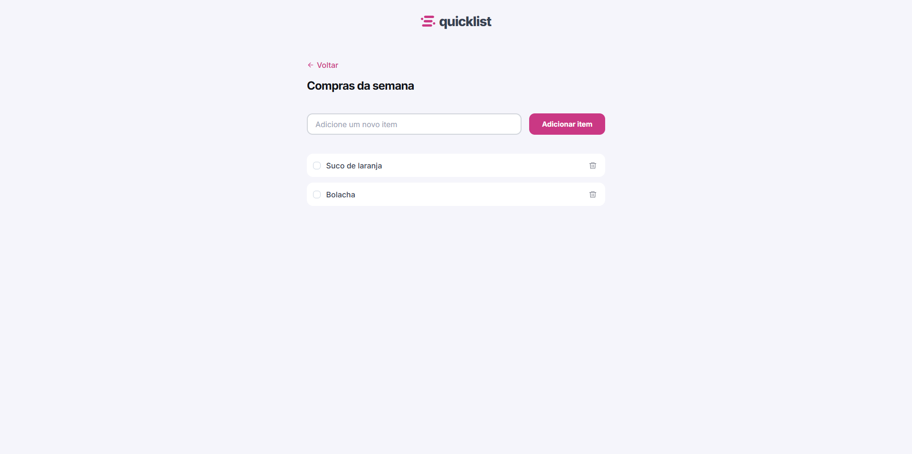

# Quicklist

Uma lista de compras simples, elegante e funcional, desenvolvida com HTML, CSS e JavaScript puro.

<div align="center">
  
</div>

## Visão geral

O Quicklist é uma aplicação web para organizar compras da semana com uma interface limpa, responsiva e fácil de usar. O usuário pode adicionar itens, marcar como concluídos e remover da lista sem qualquer backend ou configuração adicional.

## Funcionalidades

- Adicionar novos itens de compra
- Marcar itens como concluídos ou pendentes
- Remover itens da lista
- Armazenar dados automaticamente no `localStorage` do navegador
- Layout responsivo para desktop e mobile
- Interface minimalista com foco na experiência do usuário

## Como executar

1. Faça o download ou clone este repositório.
2. Navegue até a pasta do projeto.
3. Abra o arquivo `index.html` diretamente no navegador.

Não é necessária nenhuma instalação de dependências.

## Estrutura do projeto

```text
quicklist/
├── index.html
├── script.js
├── css/
│   ├── global.css
│   ├── header.css
│   ├── index.css
│   └── main.css
├── img/
│   ├── Logo.svg
│   ├── arrow-left.svg
│   └── quicklist-print.png
└── README.md
```

## Tecnologias utilizadas

- HTML5
- CSS3
- JavaScript
- LocalStorage para persistência local

## Observações

A fonte `Inter` é carregada via Google Fonts quando houver conexão. Caso a rede esteja indisponível, o navegador usa uma fonte local como fallback.
